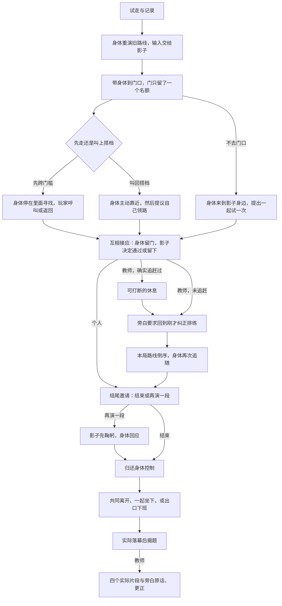

# 一次没有按计划结束的离场排练（v0.7）

本规格先于实现冻结主线；验证结果与实际时长见 VALIDATION.md。片名仍只在结尾出现，个人版完整结束、不提供回看。固定镜头、三渲二庭院、现有角色与平滑运动继续使用。

## 人物与冲突

旁白想把一位演员送出庭院，按时结束排练。身体起初服从安排；第一次与影子失散后，开始留意这个搭档。影子的行为主要来自玩家，不替玩家设定心理动机。门上的一个名额，逐渐变成两个实际到场的角色。

贯穿的问题是“怎样一起结束”，不是完成若干互不相关的小任务。前面的选择保留为事实：是否先跨过门槛、是否叫回、如何会合、有没有陪坐、谁替谁留门。后续动作与回看读取这些事实，不计算性格、善恶或信任分。

## 完整场次与分支

| 场次 | 邀请与动作顺序 | 玩家路径、回应和后续记忆 |
| --- | --- | --- |
| 试走 | “请先到门口，再回来。马上就好。”身体与影子同步。进门口才提示返回。 | 往返完成立即继续；偏离路线也使用真实记录。长时间没有有效移动，身体以明确标记的系统路线代演；绝不声称影子在代演身体。 |
| 旧动作 | 身体自然归位、先转向再重演；输入交给影子。前六秒无解释；最多重演原路线的前 16 秒，避免长路线在机制已被认出后继续重复。 | “……这一步，刚才是不是走过？”随后身体发现离开的影子，先低头、惊讶，再追。此处不评价是否服从。 |
| 两个名额 | “好，带上你的搭档。我们从那扇门离场。”门先开缝，二者到齐后关闭；身体看门、再看影子。 | 实际关门后：“名单上只写了一位。门把你们数成了两位。”门上用一、两个实体标记表现计数。未到门口的路径只说“门口还没走到。他先来找你。”不虚构关门事件。 |
| 先后选择 | 身体退开，为影子让出通往门槛的位置。旁白：“先过门，或叫上搭档。你们自己商量。” | 先走：门真正打开，影子可跨过门槛，身体留在内侧、伸手、随后寻找。叫回：身体先看向搭档，再走近；若本来就在身边，回应保持同侧，不立即用一句“名单已改”抹掉障碍。持续无回应：身体自己走近，明确记录为系统邀请，不算玩家选择。 |
| 关系后果 | 先走分支：“影子过去了。身体还留在里面。”玩家可以返回或在门外呼叫；身体先定位声音再接近。一起分支：“你们在门边会合了。这次，他想替你领路。”身体从两个门侧位置中选择更远的一个实际领路，转头确认影子。 | 记录 returned、called、body-found、stayed-close 等实际会合方式。主动呼叫不叫“躲猫猫”。身体自发找到玩家不说玩家躲藏。一起分支如果玩家走远，身体停下回头等，不直接拖玩家进下一幕。 |
| 互相留门 | 身体实际走到门边，停稳、转向门、伸手，门随后打开。先走分支身体先回头确认一次；叫回分支身体主动留出空位。 | “这回他替你留着门。过去试试，也可以留下。”玩家实际过门后，身体才迈到同一侧，两个名额同时点亮，旁白承认“一位的名单，得添上一位。”拒绝出口：身体停下等候，记录 declined，不再强迫去另一个圈。未到门口的路径也允许身体提议试门；不完成则按实际位置收束。 |
| 休息，教师条件段 | 仅在身体实际追赶距离达到阈值时进入。先减速，旁白说“刚才追得有点急。他想坐一会儿。”停稳后才坐下。 | 坐下前叫住、坐下后叫醒、停在旁边陪坐、走远让身体起身均分别记录。陪坐要在邀请可读、坐下动作完成之后确认，不继承上幕的闲置时间。起身完成才转场。 |
| 纠正，教师独有 | 门的问题已经有一个真实结果。旁白发现一人名单与实际两位不符，试图用倒序把两位排回一位。已通过与未通过分别说明眼前的结果。角色看向对方，确认这句安排。 | 倒序使用本局最近一段真实影子路线，并在说明和回看标明来源。若没有路线就明确说无路可倒，不另造。运动开始后：“我说回到刚才……它真的倒着走了。”这是旁白对自己指令的反应；倒序仍是预设表演，不声称玩家决定了导演的尝试。两者停稳会合后：“倒回去了，还是两位。好，名单改了。结尾交给你们。” |
| 结尾邀请 | 最终谢幕前才询问是否结束；身体伸手邀请，不提前鞠躬宣告完毕。 | 靠近搭档停稳表示接受，也可按“还没演完”增加双人谢幕，两版均有结构后果。邀请需要读完、角色动作完成；不会一入幕便因沿用闲置状态自动接受。 |
| 双人谢幕 | “你来鞠一躬，他来接。走一段再停下，或点一起谢幕。” | 两位先刹停，影子鞠躬；身体先惊讶，再晚 0.75 秒回应鞠躬。已接受的动作不被本幕截止时间打断。自动停步触发需读完邀请；明确按钮可跳过邀请。没有第二次倒序。 |
| 归还与真正落幕 | 减速、会合，再把输入交还身体。旁白：“现在由你收尾。走出去，或在这里坐一会儿。” | 离开：先走过的身体会在门槛确认搭档；叫回过的身体会伸手留门。留下：实际坐稳才说“两位都坐好了。这里也可以是结尾。”游走到演出收束时，出口转牌下班。标题等实际动作结束后出现，“迟到”晚到。 |

## 字幕与转场合同

- 一句台词分为请求、实际显示、结束。只有显示过的台词进入 narration 事件；结束记录实际显示区间。
- 关键台词至少留出按字数计算的阅读时间；玩家动作可以并行，快速选择的结果排在邀请之后。旧幕的无效提示撤销，不把过期排队台词带到新幕。
- 过场等待只用于完整可见的转身、坐下、起身、会合和必要阅读，不设置全局最低时长。
- 完成式台词由动作里程碑触发，不能在进入状态时预报“已坐下”“已离开”。
- 安静、相对位置和输入只作为可观测事实。导演的猜测明确使用第一人称，并标记为可更正的 interpretation。
- 回看只选择存在实际显示区间且能在录制帧中找到的字幕，明确展示原话；“旁白，说明你的安排”补充控制来源，保留原话，不把真实观察划掉当成错误。
- 普通截止时间只在没有新进展时引出角色的替代行动；持续探索有延展空间。最终绝对上限用于现场可结束性，不用来填时长。

## 时长与可行性验收

原设计预算是个人约两分钟、教师约三分钟。实际核算后，入场页改为个人约 1–3 分钟，熟练快速回应可短于两分钟；不通过静止或绕圈设置最低时长。教师实机一局 133.28 秒。完整脚本范围和独立评审边界见 VALIDATION.md、REVIEW_V07.md，不能把单局或自动策略当作新玩家分布。

每幕测量邀请、输入探索、动作响应和过场的时间；用正常合作、先走再呼叫、持续探索、全程静止、拒绝谢幕五类策略检查两版。脚本知道坐标，作为下限和可达性证据；浏览器试玩检验字幕、角色表演与控制。独立评审需在实现完成后进行，不提供本次设计过程与先前批评。

本轮只增加状态、条件、台词、少量门口标记，复用现有动作和场景。无需新角色、在线模型或服务器。课程报告仍以具体体验与自述为依据；引擎模拟和模型评审不能代替真人是否觉得有趣。
