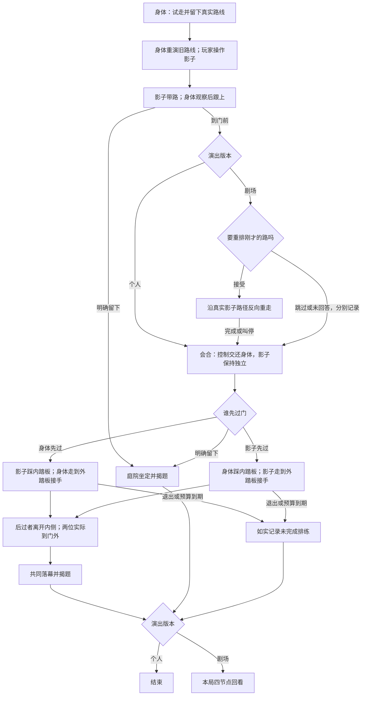

# v0.8：把搭档接出来

根据网页评估与 v0.7 两版独立首玩审查，保留真实路线、控制交换、追随与回看；删除总人数名额和多次收尾。目标是让玩家在最终离场前能理解并验证一次合作。

## 顺序与规则

1. 试走：身体到门前、回候场圈；记录真实动作。选择包含实际移动的连续片段，首尾加入平滑起停，中段保留原时序和停顿。无有效路线才标明系统示范。
2. 旧动作：身体重演，输入交给影子。最初六秒保护发现窗口；随后持续标明当前控制影子，指引引导身体到门前。
3. 追随：影子由玩家操作，身体先低头、定位、转身再追。双方到门前停稳才完成。
4. 教师可选重排：接受后沿真实影子路径反向重走，允许中断；拒绝或无回应均单独记录。它不修改门规则。学生跳过这一邀请。
5. 会合：通过对视和让位把输入归还身体；影子仍独立，不能在协作之前附着消失。
6. 留门接力：门内外两个踏板中任一被身体或独立影子占据，门打开。两位均离开且门洞净空时缓慢关闭；门叶不可扫进角色。控制身体，选择身体先过或影子先过，另一位实际留门。先过者到外侧接手，后过者才离开内侧踏板。允许离开踏板、退回再试；指引与门状态即时反馈。
7. 两位实际越过门槛并在门外踏板会合，才共同离场、一次揭题。明确选择留下则在庭院坐定揭题。预算收束与主持落幕另记，不能当作主动留下。学生无回看；教师保留四节点回看。

## 操作与未回应

每幕保留当前目标、当前输入对象、可展开的实际提示。暂停保留冻结舞台与提示。正向选择和留下按钮同时可用；按钮只执行当前仍可执行的动作。

停顿不会自动写入拒绝。没有进展时先给一次具体提示；继续没有回应时角色明确示范/接应，记为系统协助。长时间演出仍可收束为未完成排练，不伪称完成或主动同意。

## 记录与回看

区分先后选择、未选择、明确留下、系统协助、真实共同通过、预算收束、主持收束。反向重走采用弧长重新定时，准确说明来源与重定时，不称原时序倒放。第三个回看节点同时提供先后选择与接手；明确留下或结束时，从真实点击时刻播放到对应落幕动作。

## 验收

门关闭/半开/全开、内外接近、开关时占用通道均不能穿模；场景、碰撞与过门台词使用共享空间条件。长影子在边界和后廊保持可见。两种先后、反悔重试、明确留下、未回应、教师接受/拒绝/中断均能如实完成。已通过后不再要求第二次离场。

个人约两分钟、教师更丰富是设计目标，不设置最低计时。报告实际脚本下限与浏览器试玩范围，不把工具暂停墙钟或自动等待当作内容长度。

## 路径图

身体先过把等待责任交给影子，之后必须由身体接手；影子先过则让玩家亲自留门并等待搭档接手。两条路使用相同的门规则。明确留下是一项有效选择；未完成、没有回答、系统协助分别记录，不解释成心理动机。
