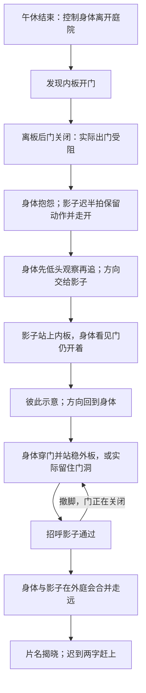
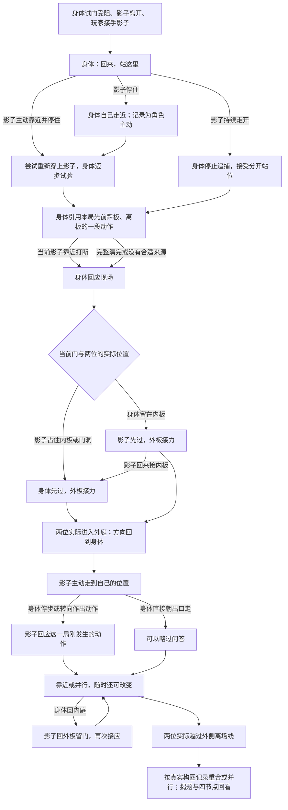

# v0.9 · 同一庭院中的两次演出

本文件描述实现。首玩证据、时间和边界另见 [REVIEW_V09.md](REVIEW_V09.md)。早期 [设计讨论](FLOW_V09_DESIGN.md) 和 [教师版方案](TEACHER_V09.md) 保留为过程材料，不覆盖本文件。

## 空间与规则

内庭、隔墙、门洞、外庭与开放的离场通道构成一条可见路线。隔墙连接两侧围墙，装饰窗为关闭的窗板。门沿墙滑入门袋，模型、实际门叶碰撞和投影裁切读取相同几何与开度。

两块踏板的纹样相同，铜线连接门机构。占住任一踏板即可开门；离开后门逐渐关闭。角色实际占住门洞时，门只保持已有开度，不能凭占位打开关闭的门。人物和独立影子都受真实墙体、花盆和当前门叶约束。任何阶段都使用这些规则；剧情不会暗中开门。

剧情选择只用方向输入。暂停、查看提示、主持控制、回看与导出属于演出工具，不是剧情分支按钮。静止不会自动判定为拒绝，也不会自动生成成功结局。

## 个人版

输入交接前两位会停步和观察。跨场持续按住的旧方向须释放或改变一次，避免玩家在观看表演时把新控制对象直接推走；界面明确显示这个状态。身体和影子使用同一套平滑运动与骨骼动画，转身先于向身后迈步。

学生结尾完整揭题，不要求观看另一块屏幕，不提供回看。合作未完成时可继续尝试，或通过暂停面板明确提前结束；后者记录为未完成。

## 教师版：独立的首次体验

教师同样从身体、庭院与闭门开始，不假定已玩个人版。分离之后增加三层冲突：能否恢复原来的一体、过去能否指导现在、一起走是否必须重合。

相遇的动作结果会影响后面的称呼和身体反应；撤脚会使搭档停止过门、再次留板后继续，回内庭会让影子重新留门。靠近、未靠近、角色自己靠近分开记录，不转换成“听话”“叛逆”人格标签。

历史引用选取最近一次真实踩板、离板前后的连续片段，最长四秒，保留停顿，片段过远或缺少移动时诚实跳过。进入和退出做时间缓动与姿态混合，内部动作保留来源；当前影子始终可受输入，门使用当前占板状态。回看分别展示源片段与引用现场，注明边缘改编，不能称为整个世界的原样倒放。

外庭问答引用最近几秒身体的实际移动，重新定位并缩放，影子以自己的步伐回应。它与旧动作引用分开标注。空间不足、没有动作素材或直接离场时不会制造一段“玩家动作”。临时靠近只是构图变化；结局以两位实际越过离场线时的位置与朝向为准。

## 台词与时长

旁白主要评论已经发生的动作。必要指引通过短目标、脚部标记、踏板颜色与门的运动共同提供，额外帮助保存在可暂停查看的提示面板。对未理解的行为只描述事实，不把一次未到目标写成主动拒绝。

没有两分钟计时锁、强制绕圈、最低游玩时长或到点代演。角色观察、转身、交接和字幕阅读占据必要时间，可以与玩家移动同时发生。程序知道所有坐标的快速策略只验证可达性，不能当首玩时长，也不能把长时间无操作计作内容丰富。

## 回看与课程报告分工

页面提供本局四个有事件锚点的片段、控制来源、实际指引与显示过的原话、开放问题。缺片段明确留空。讲稿说明具身性、审美距离、反身性和创作者预设，并邀请当事人说明意图或联想；不从轨迹推断人格或诊断。

材料：[课堂安排](CLASSROOM.md)、[手持讲稿](PRESENTER_V09.md)。课堂整体以 10–12 分钟为彩排预算，课程上限 15 分钟；实际安排依照彩排而定。
