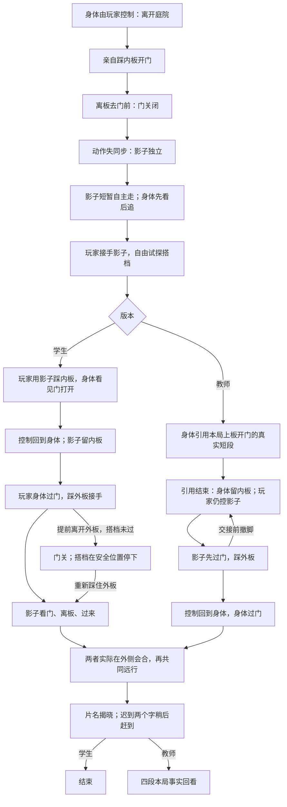

# v0.9 剧情、空间与控制交接设计

2026-11-09 的早期设计评审稿。**保留讨论过程，最终实现以 [FLOW_V09.md](FLOW_V09.md) 为准。** 评审当时运行代码为 v0.8。本稿替代 v0.8 的剧情选择菜单、后廊出口布局和持续教程式旁白；角色资产、连续运动、上方字幕、手机横屏、结尾揭题和教师真实回看继续保留。

## 改编结论

采用“离开庭院—自己开门失败—影子成为搭档—互相留门—离场”的主线。门规则始终只有一条：任一踏板被有效占据就打开，离板后关闭；门洞有人时防夹。剧情不能偷偷改变门规则。

学生版由影子留内门、身体先过；教师版让身体引用自己刚才上板的真实动作，随后留内门，玩家控制影子先过。教师版的差别发生在角色职责和玩家行动中。

删除“谁先走”“留下”“接受重排”等剧情按钮。保留入场、版本选择、暂停、声音、辅助说明、主持控制和回看操作。这些不承担角色抉择。

不加入随机反向、故意漂移或随机丢输入。开场“适应身体”通过头先看、重心跟上、起步和转身表现；当前已有平滑运动，不再叠加假的操作故障。

## 学生版：逐场动作与因果

### 1. 午休结束

开场短句：“午休结束了。请从庭院出去。”不公布正式片名，不提影子异常，不介绍踏板接力。

身体可靠响应方向输入，影子正常投射。门是唯一通向外庭的通道。地面铺装、门的亮色和踏板的材质差别建立可观察的路径，取消必走的门前圈、返回起点任务。

身体可以先走到门边、看植物、折返。程序记录真实轨迹；不因玩家绕行推断“不听话”。初次卡在关门处，身体可以轻碰门、顺着门的机械连杆看向内板；不弹出答案。

### 2. 门开了，又关了

玩家踩内踏板，踏板下沉，配重/连杆运动，门叶滑入门袋。门运动与踏板动作同一因果源，不添加假开门演出。

玩家离板去门前，踏板抬起、门关闭。内板到门安全带的距离，使身体独自来不及冲过去；这一点必须由移动速度和门关闭曲线验证，不能在快到门口时额外锁门。

首次“曾开门—离板—门实际关闭—身体来到关门前”才触发明显异常。走离踏板去看花，不立即强演“出门失败”。若玩家尚未开门，只观察关门不会触发分离。

可用一组短对话：旁白“门关得倒挺准时。”身体“我还没出去。”如果两句会盖过关键动作，只保留后一句。

### 3. 影子没有收回那个动作

门关闭后，身体做一次短的抬手疑问，再放下手。影子的手晚一点放下，随后保持了半拍自己的姿势。身体先低头发现不一致，再看向影子的头部。

影子从当前脚部位置小步移开，身体惊讶，伸手又收回。影子沿开阔地面走约 1.5–2 个角色步幅，回头看身体；身体先定位、转身，再追。

**自主路线不经过踏板、不通向出口，也不替玩家演示接力。** 它只证明影子有了自己的行动。建议无直接控制段约 3–5 秒，身体与影子的反应有重叠，不串成一长段等待。

不采用“门夹住影子”的具体物理解释：现有地面投影不支持可靠的夹影效果，强做容易把投影错误误当作剧情。异常由真实关门后的动作失同步引出，具体原因保留想象空间。

### 4. 谁在回应这次输入

影子停止自主走动、回头，脚部短线出现，玩家接手。新的方向立即决定影子的转身方向，速度和姿态平滑衔接。不能让脚本路线持续与玩家反向输入争夺位置。

身体作为现场角色看着影子，按距离和转向作出追随反应。玩家可以直奔门、试着走到身体背后、突然折返，或靠近再离开。身体分别表现追赶、先找方向、让路；这是一段可以亲自试探搭档的交互，不要求绕满一圈或完成三个动作才放行。

玩家把影子移到内板时，身体在板外停下，留出试探空间，避免两者同时踩板而看不出谁触发了门。只有影子的脚部锚点进入踏板才占板，长影的手和头覆盖踏板不算踩中。

### 5. 这次门还开着

影子占住内板，门实际打开；身体先看门，再看影子脚下。此时留出约半秒看清因果，身体说“……还开着。”或仅用动作表示。

身体向出口转身，脚部控制短线移到身体。输入交还身体；影子成为主动留门的搭档，站稳、看着身体。交接不需要点击，也不由旁白说“现在请你去门外踩另一个板”。

玩家过门后，外板的同类纹样、机械反馈和角色视线提供关联。外板在空间中从一开始就存在，不能过门后突然生成。

若玩家返回内院，影子仍留板，并对已经回来这一事实作反应。若玩家只到门外而未接手，影子留在内板、看向对方；不自动追走，不替玩家把外板踩好。

### 6. 你过来

身体踩外板并站稳，门继续打开。身体看向影子招手；可有一句“过来。”影子先确认门仍开着，再离开内板。

玩家提前离外板，门开始关闭：影子尚在内侧时停住；已经在门洞中时使用防夹安全逻辑；已经完全通过时正常跟上。不能让正在关的门穿过影子，也不能隔空把它拉到外侧。

再次踩板，影子继续过门。后续回顾可说“你离开过踏板，又回来接手”，不能说“你故意捉弄它”。

### 7. 一起离开

两者真正到外侧，先对视或看脚下，再在实际位置接近后重新匹配动作。匹配条件同时看位置、速度和朝向，不能只让渲染模型突然对齐。

持续按住前进也应能完成会合：外板接手已成立、搭档开始过门后，先行者回头查看，平滑降到约 1.1 的等候步速，仍响应输入方向；后行者可用现有最高约 2.7 的追随速度实际赶上。这里是可见的回望慢走，不是要求松手才能触发的隐藏条件。按最大分离距离验证追上所需的时间和路程，外庭必须容纳它；若容纳不了，应改路线/速度，不在镜头外瞬移匹配。故意继续改变方向可延后会合，不被记录为拒绝。

随后转为两者共同远行，保留接手时的速度连续性。外庭应有足够的相迎、站位、转身和远行空间。最终离场路线要在空间原型中可见，不能再加一扇无缘由的锁门或用透明墙拦住先行者。

正式片名在结尾出现，“迟到”两个字稍后赶到、减速停稳。学生版到此结束，无回看，也无“请看大屏”。

## 教师版：过去的身体，替现在的影子留门

开场、实际试门失败、影子分离与影子接手保持共同语言。变化发生在影子已经可控、身体决定展示刚才动作的时刻。

1. 身体看向影子，做一个引用动作的姿势：“刚才，我是这样走过来的。”它步行到选中片段的真实起点；不瞬移、不重置朝向。
2. 复演**第一次有效占板之前的一段连续真实行走，结束于身体仍在板内、门已开始响应的真实记录帧**。终点不能简单取“开门动画完成”，那时身体可能已离板。目标 3–6 秒，短记录就用短记录；内部时间、停步和方向不重新编排。返回起点超过约 2–3 秒时缩短选段；仍不合适就跳过历史引用，记录原因。
3. 玩家仍控制影子，可以靠近、走开、提前踩板或去门口。历史片段只驱动身体，门与踏板使用此刻的实时占据状态，绝不重播旧门状态。
4. 身体复演结束在内板，抬头看当前门，再看影子，恢复现场行动。它向板中心减速、站稳留门，招呼：“这回你先。”复演后的站位、目光和反应单独标记为当前动作。若引用被跳过，身体以现场动作走上内板留门，不使用引用台词，也不伪造片段；后续交接照常可完成。
5. 玩家控制影子先过门，去外板。外板稳定占据、身体已在内板站稳且引用状态为“完成”或“跳过”后，输入才交还身体。若玩家早已到外板，满足条件即交接，不补等待。
6. 影子留外板，玩家控制身体离开内板、过门、会合。身体回头或走回内院都接受输入，不自动把它拉到出口。最后仍是共同离场和迟到的标题。

这次的主题通过实际职责变化表现：同一段身体上板动作，第一次开门后身体仍在庭院里；这次让当前的影子先过去。学生知道接力办法，却会看到另一位留下、另一位先走，以及老师自己的旧路线出现在新的处境里。

不采用“旧身体在敞开的门前持续复演撞门失败”；这容易看成 AI 没有判断当前场景。也不增加“影子碰到身体就取消历史”的隐藏操作，同一动作不同时承担会合和跳过两个语义。

真实片段可能没有可辨识特征，例如只有一段普通直行。此时仍可真实展示，但不能宣称观众已经认出自己的旧动作。回看提供源片段和本次引用的对应关系，认可现场辨识可能较弱。

## 流程图

这些分支表示实际动作后果，不表示“顺从/叛逆/善良”等立场。主线不靠做出特定心理选择解锁。

## 动作分支如何影响后续

| 可观测行为 | 当下反馈 | 后面的变化 |
| --- | --- | --- |
| 身体第一次很快找到门 | 门和脚步形成快节奏；一句短调侃即可 | 教师复演很短，保持短，不编造犹豫 |
| 身体先探索、折返 | 目光、步伐和真实路线被记录 | 教师可能引用包含真实转折的短段；回看可核对 |
| 控影子后突然改变方向 | 身体先看、转身再追，距离越远反应越明显 | 后续会合时身体先确认影子方位再招呼；不重播同一个惊讶动作 |
| 影子靠近身体又退开 | 身体让出半步、伸手再收回；不瞬间转向 | 稍后留门时采用伸手邀请，回应已经发生过的接近 |
| 控制的一方已经离开外板，搭档停下 | 门真实关闭、搭档停在安全位置 | 再次接手时搭档先看门是否稳住，再迈步；增加确认动作，不加固定惩罚等待 |
| 控制的一方过门又返回 | 搭档继续留板，目光跟随返回动作 | 结尾先行者回头确认搭档，旁白可回指“刚才回来过” |
| 没有输入 | 当前角色呼吸、看向与本阶段有关的事物 | 记录无输入；不自动当成留下、拒绝或同意，也不重复催促 |

不要求玩家依次触发所有分支。它们提供多次观看时的差异，不能拿可选探索的总和充当必经内容时长。

## 旁白与角色对白

旁白可以误解、抢功、调侃自己；程序记录事实时要如实。不把玩家人格写进台词。优先让动作发生，再评论，异常出现的头一两秒留给画面。

每个事件最多一条主台词；双句对白只用于关门、第一次分离、互相接手等主要节点。相邻台词不压住前句阅读时间；离开当前状态后丢弃过时台词。一次试探不同时触发三个笑话。

| 触发事实 | 候选台词 | 约束 |
| --- | --- | --- |
| 开场 | 旁白：“午休结束了。请从庭院出去。” | 唯一默认任务说明，不讲解法 |
| 很快到关门前 | 旁白：“人到了。门还没准备好。” | 必须真的在门前、门关闭 |
| 先访问多个区域再来到门前 | 旁白：“临走前，你把院子又看了一遍。” | 不把随机移动称作故意拖延 |
| 第一次离板后门关闭 | 旁白：“门关得倒挺准时。”身体：“我还没出去。” | 门已关闭才说 |
| 影子第一次明显移开 | 身体：“你去哪儿？” | 先看见、再发声；不说接下来控制谁 |
| 身体追上后影子又改变方向 | 旁白：“刚追上，又换方向了。” | 真有追近和换向时才说 |
| 影子留内板、身体已经走开 | 旁白：“这回，没跟上来的反而帮了忙。” | 这是已发现的事实回评，不能在上板前说 |
| 身体在外板站稳 | 身体：“过来。” | 由角色招呼，替代完整操作教程 |
| 外板撤脚导致搭档停步 | 影子：“等等。” | 搭档已在门外时不能说被挡住 |
| 玩家再次占板接手 | 旁白：“好，刚才那一步接上了。” | 不能用在初次占板 |
| 教师身体引用过去 | 身体：“刚才，我是这样走过来的。” | 只在有真实片段时说 |
| 教师复演完成且身体已留板 | 身体：“这回你先。” | 不解释外板在哪里 |
| 教师影子在复演期间绕到身体另一侧 | 旁白：“他说他的。你已经绕过去了。” | 需实际跨侧；不把没有输入算作反抗 |
| 教师外板已占、身体输入恢复 | 旁白：“现在，那双腿又轮到你了。” | 状态交接已经发生，提供最少的必要说明 |
| 两位实际会合 | 旁白：“这回到齐了。” | 留白优先；可不说，让片名承担结尾 |

遇到困惑依次用：踏板/门机械反馈 → 角色看向原因 → 一句基于当下事实的提示。控制交接时可以说“试着动一下”或显示短操作提示；禁止在首次合作前说“先踩内板、再踩外板，两个人就能出去”。

## 双庭院空间

结构示意见 [v09-spatial-plan.svg](v09-spatial-plan.svg)。这是一张关系图，非最终美术或经过碰撞验证的建模图。

左侧为主庭院，右侧为完整外庭/街口，中间连续隔墙只有一处门。墙两端连接可见实体边界；不在墙外再铺看似可以绕过去的地面。后廊与高楼作为背景，开放拱洞要么属于真实可走区域，要么有明确窗台/栏杆/封闭内壁，不能靠透明碰撞假装它们关着。

保留珊瑚红建筑、暖黄主庭院、浅色外庭、青绿门、群青角色影子。细节集中在门框、踏板、真实运动的配重和角色附近；高塔不能再把可玩区域挤小。

门改为沿隔墙收入门袋的滑门。门框可以保留拱形，门扇和导轨必须与滑动结构相符，删除铰链、旋转把手和摆动门叶的表达。门袋可容纳整扇门；关闭、半开、全开使用同一几何驱动碰撞和渲染。

尺寸是原型初值，不是验证结果：

| 部分 | 初值/约束 |
| --- | --- |
| 主庭院 / 外庭 | 约 11×8 / 至少 5.5×8；必须能转身、相迎、会合 |
| 门净宽 / 两侧净深 | 1.6–1.9 / 至少 1.2 |
| 内板 | 距门平面约 3.3–4.0，偏轴 1.2–1.8；不要把板当门前装饰圈 |
| 外板 | 出门后约 1.5–2.2，位于门洞防夹区之外 |
| 隔墙前段 / 远端门楼 | 高约 .65–.85 / 3.2–3.8；前低后高，维持空间阻隔和可读性 |
| 摄影机 | 固定视角优先，先试俯角 45–55°；角色脚、两侧地面和门是取景优先项 |

固定镜头下，不采用“静态短墙藏住外板、人物过去就自动看得见”的假设。默认外板在初始画面露出部分轮廓，颜色融入地面；门开后的光线与角色视线把注意力引过去。若坚持完全隐藏，只能由实际运动的门叶解除遮挡，并在相机原型里验证。

低墙也会挡住脚。必要路线和踏板应离遮挡墙背面约 1.0–1.2，最终按实际投影检查。不能通过降低墙模型、保留高墙碰撞来假装视线问题已解决。

## 控制、门和投影的实现约束

### 三个交接

| 交接 | 触发 | 连续性与反馈 |
| --- | --- | --- |
| 身体输入 → 自主片段 | 首次实际开关门、身体到关门前、疑问动作产生失同步 | 从当前真实位置起演，先看后转，脚部不跳点；当前输入仍有即时指示，但不暗称它在操控角色 |
| 自主影子 → 玩家影子 | 影子完成短离开与回看姿势 | 同帧改变输入来源和脚部反馈；方向响应目标 ≤100 ms，速度/姿态过渡约 .12–.20 s；反向输入不被旧路径拉回 |
| 玩家影子 → 玩家身体 | 学生：影子稳定占内板且门已打开；教师：身体已实时留内板、引用完成或跳过、影子稳定占外板 | 影子继续真实占板；身体所在位置清楚可见；旧持续按住的方向须经松开或换向再送给新对象，持续按住时才显示“松开方向，再迈一步” |

所有交接以模拟帧为准。暂停不能重复触发交接或抹掉当前接手条件。最终共同远行另记为落幕驱动，不把它冒充玩家继续操控。

分离首帧继承当前影子的根位置、速度、朝向与骨骼姿态；疑问动作的延后收势通过姿态连续过渡实现，不能重新加载 idle 或把 yaw 初始化为固定角度。归还身体和最后匹配也保留实时朝向，反向行走先观察、转身，再前进。

### 物理规则

- 独立影子的脚部锚点与身体使用相同门洞碰撞。附着影子不算第二位占板者。
- 内板释放后到门洞安全带的最短距离 `d_min`，应满足 `d_min > v_max × t_passable + 0.4`；还须用真实加减速和逐帧碰撞遍历验证。不能只凭图上距离断言单人无法冲门。
- 滑门防夹区只在门洞净空，不沿用旧铰链整片扫掠区。占据安全带只能保持当前开度，不能将已关闭的门打开。
- 门未足够打开时角色停在门前，不擦着半开门穿过。外板离开后按当前双方位置决定停步/继续，不能只看剧情阶段。
- 外板接手后同伴才离内板。不得把“按了某个剧情选择”当作踩板或跨门已经发生。

### 长影子

现有角色投影直接铺到地面，root 碰撞不会限制长影轮廓。新隔墙必须同步加入投影遮挡，避免脚在左院而头形透到右院。

拟采用舞台化的地面截断规则：以脚部锚点到投影片元的连线检查首次实体墙阻挡；门开时只通过真实门洞。另以可接收地面区域裁掉平台外投影。该方法是清晰的图形规则，不声称物理光线完全正确；不得把整条长影当刚体扩大碰撞半径。

投影脚部锚点、控制短线、踏板判定和重合判定必须共用坐标。维持当前太阳方向为首版原型基准，先解决遮挡，再决定是否继续拉长；不能为填补空间错误持续放大影子。

## 回看与课程表达

教师回看四个真实节点：首次自己开门又关门；影子分离和输入接手；历史身体上板与当前影子行动并存；外侧接手与共同离场。

记录 `actorDriver`、原片段起止时间、引用游标、交接时刻、踏板占据者、门开度、双方实际位置、当前对白、系统协助和主持操作。源片段不足/跳过要明确记录。原门状态与现门状态分别保存。

回看先放画面，再叠加输入/驱动来源，最后提出问题。可以据此谈具身性、从操作者到观看者的审美距离、旁白和创作者如何安排“正常路线”的反身性。玩家是否认出旧动作、为什么撤脚、有没有感到控制变化，需要当事人自述。记录不能证明心理、人格或疗愈效果。

## 时长与验证

独立流程盲审估计用户提出的学生主线有效内容约 **60–105 秒**。本稿的可操作试探和失败恢复可能使首玩接近两分钟，但仍不能据此保证两分钟。学生熟悉路线后更短是合理结果。

教师短引用、职责反转本身预计比相应直接过程新增约 **10–25 秒**；其余时长来自真实试探，不能重复计算门的接力。这一版不承诺 3–3.5 分钟教师纯游玩。课堂可把额外时间用于真实四片段回看与讨论，无须用失控、沉默或多绕路补足。

如果课程准备仍希望个人首玩普遍在两分钟左右、教师本体普遍达三分钟，应先用原型测量。这套设计若实测明显过短，需要再加入一个有独立动作后果的场面，不能把它隐藏成“再等几秒”的参数改动。

验收分为三层：

1. **空间/机制**：关闭门时两庭院不可互通；开门时身体与影子都能连续通过；板边斜向冲刺、半开门、撤脚、防夹、暂停恢复、低帧率均无穿模；影子轮廓无隔墙孤立蓝块。
2. **控制/剧情**：不按剧情按钮完成两版；连续按键、松手、反向输入、摇杆均可接手；自主段不替玩家踩板；教师原片段和现场动作来源准确；所有分支台词匹配事实。
3. **首玩体验**：邀请未读设计的玩家，用同一份中性操作说明测试。记录首次发现踏板、发现影子可控、过门后首次接手、卡住点、主动操作时长和非操作时长。事后询问“你刚才在做什么”“哪个动作是你控制的”“哪一刻不清楚”，不先透露答案。

本轮完成的是截图核查、源码审核与文字方案盲审，尚无新版本试玩数据。不能把代理文字意见或脚本通关时间称为真实玩家验证。

## 实施顺序

先做两庭院可走的空间原型和真实门板碰撞，再做学生主线与交接；确认无菜单也能被理解后，接教师引用与职责反转、真实记录和回看，最后补美术、投影裁剪和节奏打磨。每一步沿用已有平滑运动和资源来源，避免用整套角色重做掩盖剧情问题。
