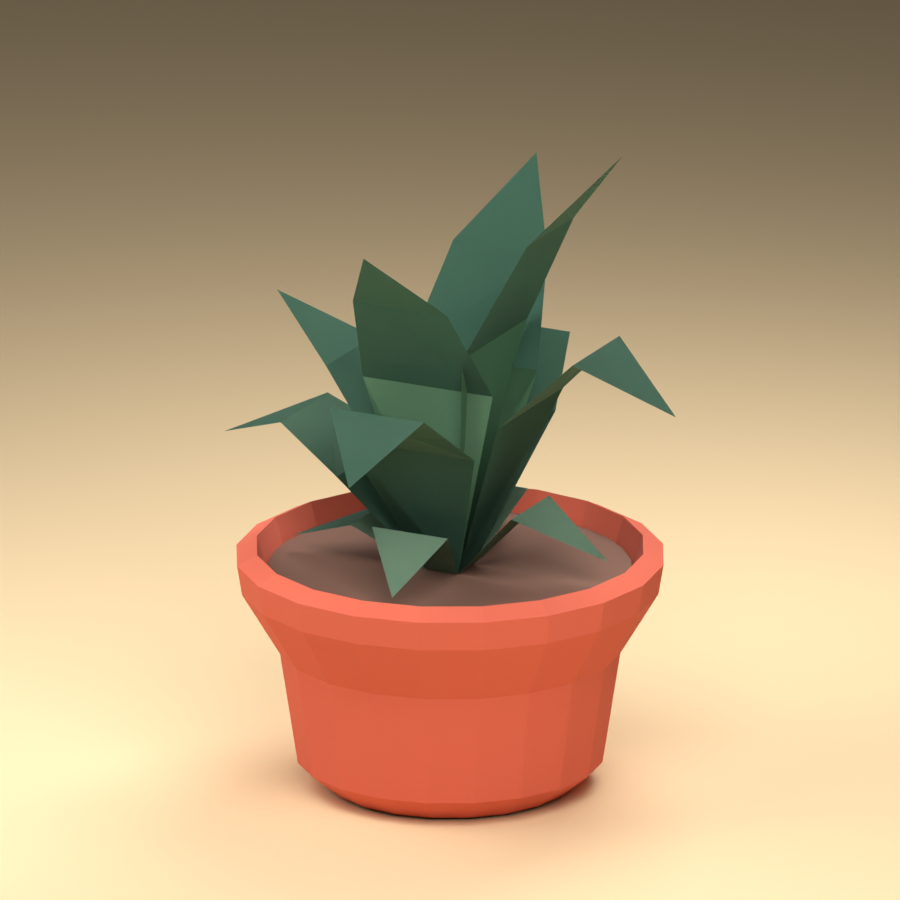

# Courtyard plant asset

The courtyard uses **Kenney Nature Kit / `plant_bushDetailed`**, an existing CC0 model. Its layered, pointed leaves form a compact rosette with actual folded surfaces. This is a stylized plant, without an exact species claim. The existing coral planters remain scene geometry; this asset replaces their foliage only.

## Selection and provenance

Two authors were compared using their official sources:

| Source | Assessment |
| --- | --- |
| [Kenney Nature Kit](https://kenney.nl/assets/nature-kit) and [Furniture Kit](https://kenney.nl/assets/furniture-kit) | Both list CC0. Furniture Kit's potted foliage was especially sparse; Nature Kit's `plant_bushDetailed` supplies a fuller, layered leaf rosette. The actual Nature archive and model were downloaded and inspected. |
| [Quaternius Ultimate Nature](https://quaternius.com/packs/ultimatenature.html) | The official pack lists CC0 and provides a public Google Drive source folder. Direct file downloads returned Google's “Quota exceeded” response during this session. No Quaternius file is included. |

The selected archive's included license identifies **Nature Kit (2.1)** and Creative Commons Zero. Attribution is not mandatory under that license, but the original `License.txt`, untouched source GLB, original author, stable source URL, and archive/model/license SHA-256 hashes are retained in `assets-src/vendor/kenney-botanical/PROVENANCE.json`. The full source pack is not required at runtime.

## Delivered files and adaptation

| File | Purpose |
| --- | --- |
| `public/assets/courtyard-plant.glb` | Runtime foliage, 11,152 bytes, 104 triangles, 232 authored vertices, three flat color materials, no textures or pot |
| `public/assets/courtyard-plant-manifest.json` | Bounds, palette, source, license, transformations and runtime hash |
| `assets-src/vendor/kenney-botanical/plant_bushDetailed.glb` | Untouched upstream model |
| `assets-src/vendor/kenney-botanical/courtyard-plant.blend` | Compressed editable derived foliage source |
| `assets-src/vendor/kenney-botanical/preview.png` | Offline preview in an approximation of the existing planter |
| `scripts/build_botanical.py` | Reproducible Blender import, adaptation, export and preview |
| `src/botanical-assets.ts` | Loader, material adaptation, rooted wind and lifecycle |

The original mesh topology and leaf arrangement are retained. Height is normalized to 1.0; horizontal dimensions are reduced to 64% to fit the courtyard pots. Exported width and depth are each 1.069968. The GLB uses Y-up and its soil-level root is `[0,0,0]`. Three greens (`#648C6B`, `#83A385`, `#416956`) are assigned by the original faces' orientation. There are no generated replacement leaves, image textures, or added mesh detail.

Rebuild with Blender 4.5 LTS:

```sh
blender --background --python scripts/build_botanical.py
```

The saved `.blend` and GLB contain foliage only. The generator adds a planter approximation and lights after saving/exporting, solely to produce the preview.

## Integration

```ts
const plant = await addBotanical(soilGroup, {
  height: 1.8,
  seed: 2,
  materialFor: color => sceneMaterial(color, 'environment', THREE.DoubleSide),
});
plant.update(frame.t, motion.wind);
// When the owning scene is destroyed:
plant.dispose();
```

Place `soilGroup` at the existing pot's soil surface (currently local y = 0.87). `height` is measured above that surface in parent-local units. `seed` controls orientation and wind phase; optional `rotation` overrides orientation. The returned root is attached to the supplied parent and its translation remains unchanged during wind animation.

The source GLB is loaded once and cached. Instances own their cloned geometry. Material factory results are **borrowed**: they are not cloned, have no properties changed, retain their shader hooks, and are not disposed by the plant. The caller supplies DoubleSide materials if required. Without a factory, the module creates and owns DoubleSide toon materials. Removing a plant disposes its geometries and only its own default materials.

Wind changes the actual vertex positions using absolute scene time, so geometry and cast shadows move together and replay seeking produces the same pose. The lowest 8% of height remains fixed. A smooth height-squared envelope gives leaf tips more motion than the base. At height 1.8, the configured wind produces only a few centimeters of tip movement. Wind does not rotate or translate the entire root and does not accumulate deformation frame by frame.

## Verification

The generated asset was inspected in its offline render, and TypeScript checking passed. `node scripts/check_botanical.mjs` loads the actual shipped GLB through the actual TypeScript module and samples 241 frames over 12 seconds. Its machine-readable result is `assets-src/vendor/kenney-botanical/runtime-validation.json`. It checks finite vertex positions and normals, pinned base vertices, moving tips, deterministic absolute-time updates, stable root transform, preserved borrowed shader hook, and correct geometry/material disposal. The main scene's final browser integration is validated separately by the parent task.


