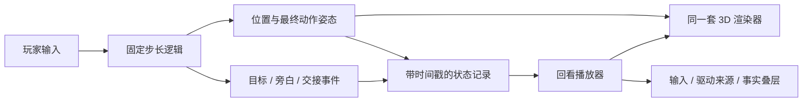

# 正午排练场 / Noon Rehearsal — 技术与美术路线

更新：2026-10-27（第二版动作与角色修订）。正式片名：《我的影子迟到了》。

状态：本文件保留设计依据。现已实现浏览器 demo，机制位于 `src/engine.ts`，渲染位于 `src/scene.ts`。当前实现范围和验证事实见 `docs/VALIDATION.md`，不能将下面所有设计目标都理解为已经完成的功能。

## 1. 当前叙事决定

依据引用对话《评估报告形式》的最新讨论，以及本聊天最新修正：

- 开场只显示「入场 / 正午排练场」，浏览器标题、加载页、分享摘要和二维码说明不提前揭示影子机制。仓库与部署名称采用 `noon-rehearsal`，避免 URL 提前揭题。
- 自然投影从开场存在；前约 20–30 秒身体跟手、影子正常，建立可信关系。任务为「请先到门口，再回来。马上就好。」
- 首次明显控制变化后保留 6–8 秒观察窗口；不能通过切镜头、换配色、控制对象标签、箭头突然转移等提前解释。
- 结尾保留本局姿态，短暂停顿后揭晓《我的影子迟到了》；标题的投影晚半拍到位。
- 个人版也完整结束、揭题、允许本局回看。不要求显示「请看大屏」。同学观看教师版相当于观看二周目。
- 教师版增加身体休息、谢幕互动、最近约 8 秒影子路线的倒放。趣味来自本局操作与角色表演，不依赖观众不知道机制。

## 2. 推荐路线

**采用 3D 建筑和骨骼角色 + 固定正交镜头 + 受控色阶与轮廓线，形成 3 渲 2 画面；玩法在地面二维平面上进行。**

3D 指资产与空间组织，3 渲 2 指视觉呈现，两者不矛盾。不会因为选择了 3D 而增加自由镜头、复杂物理、跳跃或开放探索。先完成一个能代表最终品质的庭院和角色。

| 路线 | 本项目收益 | 主要代价 | 决定 |
| --- | --- | --- | --- |
| 纯 2D 分层插画 / 骨骼 | 构图与笔触容易精修，运行轻 | 多方向转身、遮挡、贴地投影、身体与影子同形的动画需另做；用简单 SVG 会较容易停留在原型质感 | 不作主路线；UI 保留 2D |
| 常规 3D / PBR | 空间、光照、骨骼工具成熟 | 写实材质与环境需求增加，容易偏离浓色清线风格 | 不作美术目标 |
| 固定镜头 3 渲 2 | 同时支持空间、转身、丰富动作和统一图形语言；适合剧场与身体投影 | 需要专门调线条、阴影色、角色轮廓和移动设备渲染 | 主路线 |
| 预渲染背景 + 实时角色 | 固定视角可获得精细背景，运行成本低 | 遮挡与投影匹配更复杂，换画幅限制多 | 性能后备，不在首版同时维护两套完整管线 |

浏览器实现使用 TypeScript + Vite + Three.js/WebGL2。页面、字幕、回看控制采用 HTML/CSS。模型交换用 GLB，资产制作保留 Blender 源文件与生成/导出脚本。资产已经通过官方 Blender 4.5 LTS portable 工具链生成；无需玩家安装 Blender。

Three.js 提供正交相机、toon 材质、骨骼动画和 glTF 加载能力，但这些只证明工具适用，不证明本项目已经达到艺术目标。主要验收对象是浏览器里的实际运动画面。

## 3. 画面如何达到完成度

### 构图与场景

- 固定轻俯视的正交镜头，角色轮廓在同一屏幕位置具有稳定比例；换控制关系时镜头不变。
- 前景框景、中景可活动庭院、后景拱廊与楼梯形成三层深度。活动区域尽量处于同一地面；高台主要承担场景构图。
- 先设计建筑比例与负空间，再制作拱门、柱头、台阶、檐口、栏杆、门板与花盆模块。程序化建模服务于这些明确形状，不能用通用立方体堆叠作为成品。
- 背景阴影采用暗珊瑚/褐红，演员影子采用受控群青；二者方向、落地关系一致。开局不给演员影子眼睛、发光、专属描边或粒子。
- 蜂蜜黄、珊瑚红、奶油白、群青、深靛蓝、薄荷绿为起始色板；实际色值以浏览器与投影可读性调整。

### 渲染

- 主色使用平涂，亮面/暗面以两到三档色阶组织；重点调色阶边界和颜色，不依赖「把 ToonMaterial 套上」作为完成标准。
- 建筑只强调外轮廓与有意义的结构边，不能绘制所有三角面边线。
- 角色优先用外壳描边，检查关节和面部是否挤成黑块；场景结构线可单独建模。屏幕空间轮廓后处理仅在收益明显时启用。
- 控制线宽在实际画幅内的视觉尺寸；手机缩放后不能消失，投影时不能吞掉表情。
- 轻微纸感/颗粒可作为最后一层，保持低对比、不随帧闪烁；不把滤镜当成造型的替代品。
- 布料使用短链骨骼与受控动作，不引入实时布料仿真作为必要依赖。

### 角色表演

当前主角改用 Kay Lousberg 的 KayKit Hooded Rogue（CC0），保留成熟网格、蒙皮与步态，并改配色、补充剧情动作。此前自制模型保留在历史版本中。具体来源与动作数据见 `CHARACTER_ASSETS.md`。

首版动作库：站立/呼吸、眨眼、走路、转身、低头看影子、回头、急停、前倾追赶、摊手/整理衣服、坐下、起身、鞠躬。可由约 8–12 段基础动作与视线/上身叠加组合。

身体根节点移动由游戏逻辑决定，动画采用原地步态；步频与实际速度匹配，避免脚滑。转身有轻微预备和跟随，但不能拖慢玩家的直接位移响应。披风与围巾只提供少量延迟，影子分离时不以物理碰撞决定剧情。

## 4. 3D 资产从哪里来

| 资产 | 主要来源 | 具体处理 |
| --- | --- | --- |
| 主角 | KayKit Hooded Rogue，CC0 | 使用成熟角色与专业步态；改成适合庭院的纯色材质，补充鞠躬、挣扎和起身，保留来源与可编辑改编工程 |
| 庭院建筑 | 原创模块化建模 | 参数化拱门/台阶/檐口，整体构图固定，微调比例与轮廓；共用调色板 |
| 主角影子 | 主角网格/骨架的投影副本 | 不单独采购；初期与身体同姿态，后期由独立逻辑根节点驱动 |
| 普通道具 | 自制优先；必要时 CC0 库 | 逐项核对资产附带许可、重设材质与比例，不能直接混用不同画风 |
| 动作 | 针对角色定制关键帧 | 必需动作不依赖外部账号。Mixamo 可作基础动作备选，需先确认账号可用性、角色比例和源文件分发条件 |
| AI 生图 / 图生 3D | 视觉探索或可选原料 | 概念图可以启发模型；生成网格须检查背面、拓扑、面数、关节和穿模。不能把「生成成功」等同于「游戏可用」 |

Kenney 官方说明其资产页游戏素材为 CC0，实际引入时保留包内许可。Mixamo 官方说明自动绑定适用于双足类人，并对夸张比例、大衣物等有限制；其 FAQ 还列出中国地区账号限制。故 Mixamo 不作为这次项目的关键路径。

Meshy 官方现有工具可生成/绑定部分角色，但需要外部服务与资产清理，且网页工具和 API 的支持范围并不完全一致。当前不把其可用账号、额度或成品质量视作既有条件。若后续采用，只作为局部生产路线，最终必须进入相同 Blender 清理、导出和浏览器验收步骤。

资产交付应包括 `.blend`/生成脚本、游戏用 `.glb`、动作名称表、色板与许可记录。不要只留下运行时不可编辑的几何体或一张效果图。

## 5. 两类阴影的实现

环境阴影与剧情中的影子分开管理：

1. 建筑/花盆等使用静态阴影或低频更新的环境阴影贴图，统一主光方向。
2. 主角的剧情影子使用一套不可见的影子演员骨架，其变形后顶点按主光方向投影到庭院地面，再绘制为单色轮廓。
3. 开场影子演员的位置、朝向、骨架姿态复制身体，因此它看起来是正常投影。身体关闭另一套重复的普通投影，避免出现两个长影子。
4. 控制交换只改变影子演员的驱动来源。影子仍使用同一投影方式与色彩，不通过更换素材暗示转折。
5. 投影使用地面深度关系与小偏移避免闪烁；在墙体/台阶前正确遮挡，不允许把影子直接叠在所有建筑之上。

首版主要活动区限定为一个地面平面，避免投影跨台阶、墙面与多层地板时突然折断。若以后需要影子爬墙，应作为新的空间机制实现，不能临时用贴片糊过去。

## 6. 核心机制与运动架构

逻辑坐标使用庭院世界坐标 XZ，独立于屏幕尺寸。键盘方向映射到相机的地面方向，保证按左时屏幕向左；手机固定控制区提供即时输入反馈，但不提前标出当前控制对象。

分开维护：

- `InputRouter`：当下输入给身体、影子或暂不直接驱动。
- `BodyActor / ShadowActor`：世界位置、朝向、动作姿态、驱动来源。
- `StageDirector`：剧情阶段、事件、目标、旁白、时间上限。
- `Recorder / ReplayPlayer`：只记录、回读已发生状态。
- `SceneRenderer`：把状态转成 3D 画面，不决定剧情。

| 段落 | 身体驱动 | 影子驱动 | 关键处理 |
| --- | --- | --- | --- |
| 正常入场 | 当前输入 | 同步自然投影 | 可靠操作、真实路线含停顿；不开局强调异常 |
| 旧动作继续 | 已记录的身体路线 | 当前输入 | 连续归位；6–8 秒安静；重演保留原时序 |
| 身体追影子 | 跟随影子的运动控制 | 当前输入 | 有转头、追赶、急停；不靠完整物理系统 |
| 过去带路（教师版） | 跟随影子 | 最近约 8 秒影子路线倒序引领 | 从当前位置平滑开始，沿真实路线倒序引领，起止加减速并等待会合；当前输入仍记录并显示反馈 |
| 重新接回 | 当前输入，从此刻位置开始 | 短过渡后恢复投影关系 | 不瞬移，不立即弹出「控制已恢复」 |

碰撞采用轻量运动学控制器与明确可行走区域/少量简单障碍；追随需要绕障碍或保持可行走路径，不能直穿花盆和台阶。首版不引入重力、跳跃、布料碰撞与布娃娃系统。

逻辑用固定 60 Hz 步长，绘制跟随 `requestAnimationFrame` 并插值。页面失焦暂停逻辑和声音、清空输入，恢复需明确继续。长帧的补算要有上限，超过上限暂停处理，不能偷偷丢掉一大段演出时间。

正常完成、持续静止、未返回起点、反复转向、提前抵达、主持人跳过都必须有界结束。若缺少有效路线，系统代演需明确标记；系统归位与玩家路线分开记录。

## 7. 回看：记录结果，再重绘

游戏内身体重演、教师版影子倒放、结束后的证据回看是三个独立功能，不能混用一条不带来源的轨迹。

### 保存什么

- 状态采样目标为 30 Hz；阶段交接、输入变化、目标进入、旁白和主持人操作另存精确的游戏时钟时间。
- 两个演员的位置、朝向、动作片段/相位/混合权重、视线与上身覆盖参数。
- 为确保暂停和任意拖动后的动作一致，优先额外保存最终骨骼旋转与动态局部位移；回看插值已记录姿态，不重新运行动画选择或追随逻辑。
- 影子的投影方向/参数、当前关系、舞台门与标记状态、字幕文本/事件 ID，以及所有可见程序动画需要的相位。
- `schemaVersion`、构建版本、资产版本与设置。回看跨版本不兼容时明确提示，不能无声套用新动作。

使用紧凑二进制/TypedArray 保存高频数据，JSON 保存事件和清单。以两个各 24 关节的演员、每关节旋转四元数 Float32、30 Hz、180 秒估算，仅旋转数据约 4.1 MB；计入局部位移、根节点与其他数据预计数 MB 到十余 MB，需实测。完整会话先保留在内存，按需要存 IndexedDB；用户主动导出，不上传服务器，不写入仓库。

### 回看怎么播放

按时间戳查找两帧：位置线性插值、旋转四元数插值、离散事件采用正确时间侧。使用与原局相同的相机、材质、模型、字幕与音效事件。光线和可见风动也由记录时间驱动。回看不能重新抽旁白、重新判目标或让追随 AI 再走一次。

原画面回看与分析叠层分离：先播放 8–12 秒真实片段，再暂停打开输入箭头、身体/影子轨迹与驱动来源。四个节点由实际事件时间索引生成：最初指令、第一次交接、谁带谁走、一次旁白解释。不存在的事件不能生成假片段；人工跳过与系统代演必须可见。

「旁白，改口」保存为追加的解释修订，不改动历史帧和原始台词。界面可划掉旧解释并显示「本游戏不知道你为什么这样走」，同时允许当事人补充自述。

这是游戏状态的回看重绘，不等同于屏幕录像，也不承诺不同 GPU 上逐像素一致。课堂备用另做经过检查的真实录屏，不能用未来分支重演冒充历史录像。

## 8. 字体与声音

- 标题和章节：思源宋体 / Noto Serif SC，以有力度的中等或较粗字重测试，避免投影中细横画丢失。
- 指令和操作：思源黑体 / Noto Sans SC，保持尺寸与对比度，不用书法字体承载关键操作。
- 结尾标题可基于排版制作独立字标，微调字距和分行；不使用生成图片中的伪文字。
- 字体本地 WOFF2 打包，保留 OFL 许可。静态文案可以子集化；玩家自述输入需完整字体或清晰的系统回退，不能缺字。
- 声音默认静音可玩，通过开始/声音按钮启用。基础是步伐、衣料、影子摩擦、门/谢幕与极少量环境声；克制的音乐不给第一次异常提前报信。
- 所有声音事件记录时间与 ID，暂停与回看不得重复触发或跨时间乱播。

## 9. 完成标准与制作顺序

### 第一关：视觉与运动小样（约 30–45 秒内容）

一处达到目标风格的庭院、一名正式轮廓和骨架的角色、自然投影、正常走路/转身/停步、一次影子脱离与追随、一次可暂停拖动的原局回看。必须看运动结果，不能只拿静帧美图验收。

重点检查：是否还有占位人偶感；轮廓/配色/空间是否统一；开场影子是否可信；走路是否脚滑；影子分离是否突变；回看是否恢复同一姿态；手机画幅与投影阅读是否清楚。

### 第二关：完整体验

个人版约 2 分钟、教师版约 3 分钟为节奏目标；不靠强迫等待凑时长。补齐五种关系、丰富角色反应、旁白调度、所有非配合分支、完整落幕与个人/教师共同揭题。

### 第三关：回看与课程表达

完成四节点、原画面/证据叠层、改口、导出与主持人控制。实际试玩记录和参与者自述由真实体验产生。审美距离、具身性与反身性的解释连接到具体片段，不把行为计数变成人格判断。

### 第四关：发布验收

桌面和手机浏览器验证；完全不输入、持续绕圈、失焦恢复、跳过、提前退出、回看拖动都可正常完成。部署到 GitHub Pages，检查 Actions 成功与线上资源加载，补充本地运行方式及离线/录屏备选。

性能先设为预算而非结果：桌面目标 60 fps、手机目标至少稳定 30 fps；初次关键资源目标约 10 MB 以内。渲染分辨率可降，关键动作与输入时钟不随画质降级。实际设备测试后再承诺兼容范围。

## 10. 当前 demo 与后续制作的界线

- 已替换旧开场：片名后置，入场不说影子，身体与投影同步。
- 已使用世界 XZ、相机相对输入、运动学碰撞与绕花盆追随。
- 已采样最终关节位移、旋转与缩放，包含眼部动画；用 Float32Array 在内存存储，导出时 gzip 压缩 JSON。暂未提供 IndexedDB、导入界面或长期会话管理。
- 场景为原创程序化 3D 建筑；主角为 KayKit CC0 资产改编，保留 Blender 工程、骨骼 GLB 和十段动作。坐下、起身分别有完整片段。
- 个人与教师版都揭题、回看。教师版包含休息、谢幕标记与最近八秒路线的倒序引领。路线按弧长重定时，通过平滑运动控制器跟随，起止加减速；末端先会合再交回控制，不声称逐帧倒放原始动作。
- 目前是单场景艺术 demo，没有自由镜头、跨高台投影或真实布料物理。音效是可选的简单合成脚步与入场提示，完整配乐和声音导演仍是后续工作。
- 工程验证不代表不知情参与者一定能认出旧动作；课程体验和审美评价要由真实试玩补充。

## 来源

- 用户提供的 ChatGPT 对话《评估报告形式》，已读取截至 2026-10-27 本次访问中的最新讨论；个人版结尾以本聊天最新修正为准。
- 用户提供的《艺术＆疗愈》小组报告 PDF，15 页；特别核对第 6–9 页概念、第 12–14 页报告与记录要求。
- Rundisc 开发者的 Game Camp 2024 演讲《Le rendu de Chants of Sennaar : faire un jeu 3D sans textures》：https://www.youtube.com/watch?v=LEXBpVAYwI8 。用于确认参考作品确有 3D/风格化渲染路线，不据此声称复刻其专有管线。
- Three.js 正交相机：https://threejs.org/docs/pages/OrthographicCamera.html
- Three.js Toon 材质：https://threejs.org/docs/pages/MeshToonMaterial.html
- Three.js 动画播放器：https://threejs.org/docs/pages/AnimationMixer.html
- Kenney 素材说明：https://kenney.nl/support
- Mixamo 官方 FAQ：https://helpx.adobe.com/creative-cloud/faq/mixamo-faq.html
- Meshy 网页绑定说明：https://docs.meshy.ai/en/webapp/guides/3d-model/rigging

以上技术和性能数值是本项目的设计选择或预算，未完成的部分均不视作当前能力实测。

## 第二版针对试玩反馈的修订

- 输入先生成期望速度，再经过加速度和加加速度限制；朝向也限制角速度与角加速度。
- 动作采用持续的多片段权重，打断过渡时保留当前混合状态。走跑共享落脚相位，按实测步幅与实际位移推进；坐下后先起身再移动。
- 门口、白圈和谢幕圈只在近处轻微吸附，不阻止主动离开。回白圈后约 0.45 秒稳定即继续，取消旧版 18 秒门槛。
- 跟随不再永久保留空间偏移。影子停下后身体追到同一根位置；姿态在约 0.65 秒内接回自然投影，再同步落幕。
- 独立影子停留、身体继续走时，影子做脚底保持的上身抵抗动作；不凭空改变影子的位置。
- 上方独立字幕带是本项目的构图选择。底部居中是常见惯例，但此游戏关键信息在脚步、影子与圆圈，避免字幕遮挡这些元素。参考 [IGDA](https://igda-gasig.org/how/platform-level-accessibility-recommendations/notification-positioning/) 和 [Xbox XAG 104](https://learn.microsoft.com/en-us/gaming/accessibility/xbox-accessibility-guidelines/104)。
